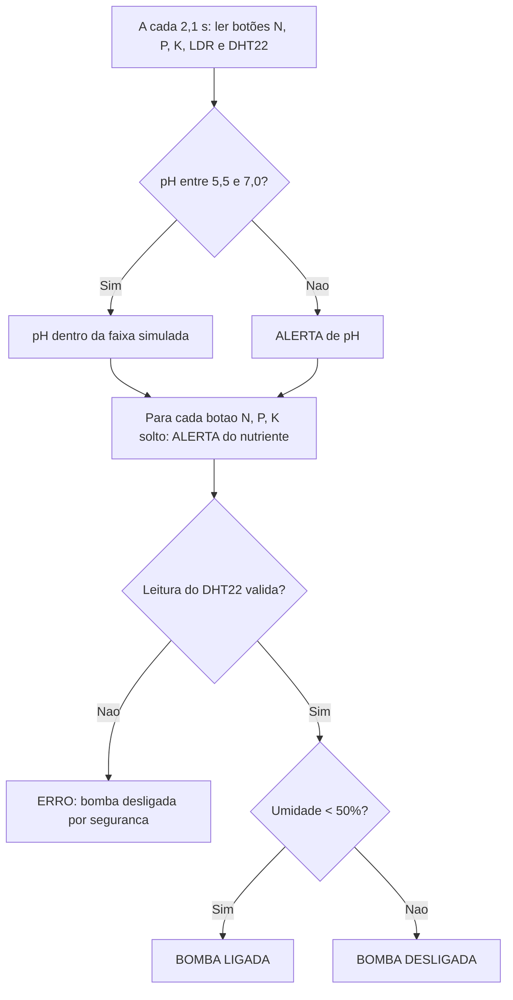

# FarmTech Solutions — Fase 2: Sistema de Irrigação Inteligente (ESP32 + Wokwi)

Simulação de um dispositivo de coleta de dados e irrigação automatizada para uma lavoura de **milho**, construída no simulador [Wokwi](https://wokwi.com) com ESP32.

- **Projeto no Wokwi:** https://wokwi.com/projects/477882046949237761
- **Vídeo de demonstração (YouTube, não listado):** `COLE_AQUI_O_LINK_DO_VIDEO`

## Integrantes

| Nome | RM | Papel |
|---|---|---|
| (nome) | (RM) | Integrante 1 — Hardware (montagem no Wokwi) |
| (nome) | (RM) | Integrante 2 — Entradas e sensores |
| Raila Santos Cruz | (RM) | Integrante 3 — Lógica e atuadores |
| (nome) | (RM) | Integrante 4 — Regras agronômicas |
| (nome) | (RM) | Integrante 5 — Repositório e vídeo |

## 1. Objetivo

Monitorar umidade, pH e nutrientes (N, P, K) e decidir automaticamente quando ligar a bomba d'água (relé azul), reduzindo desperdício de água. Como o Wokwi não tem sensores agrícolas, foram feitas **substituições didáticas**:

| Grandeza real | Componente no Wokwi | Como é usado |
|---|---|---|
| Nitrogênio (N) | Botão verde "N" | Pressionado = nutriente marcado como disponível |
| Fósforo (P) | Botão verde "P" | Pressionado = nutriente marcado como disponível |
| Potássio (K) | Botão verde "K" | Pressionado = nutriente marcado como disponível |
| pH do solo | LDR (sensor de luz) | Leitura analógica convertida para a escala de pH de 0 a 14 |
| Umidade do solo | DHT22 | Umidade relativa do ar usada como indicador simplificado da umidade do solo |
| Bomba d'água | Relé + LED azul "BOMBA" | Relé ligado = bomba ligada |

> Os componentes **não medem** pH, umidade do solo nem concentração de nutrientes. Os resultados servem apenas para demonstrar a lógica do sistema em ambiente virtual.

## 2. Circuito


| Componente | Pino do ESP32 |
|---|---|
| DHT22 (dados) | GPIO 4 |
| Botão N | GPIO 12 (`INPUT_PULLUP`, pressionado = `LOW`) |
| Botão P | GPIO 13 (`INPUT_PULLUP`, pressionado = `LOW`) |
| Botão K | GPIO 14 (`INPUT_PULLUP`, pressionado = `LOW`) |
| LDR (saída analógica AO) | GPIO 34 |
| Relé (entrada IN) | GPIO 5 (`HIGH` liga a bomba) |

Biblioteca utilizada: **DHT sensor library** (arquivo `wokwi/libraries.txt`).

## 3. Cultura escolhida e regras de decisão

A cultura escolhida é o **milho**. Materiais técnicos da Embrapa indicam uma faixa de pH favorável aproximadamente entre **5,5 e 7,0**, dependendo das condições do solo e do manejo.

A irrigação e os alertas de pH/nutrientes são tratados **separadamente**: pH inadequado ou nutriente não marcado gera apenas alerta e **não impede** a irrigação, porque a necessidade de água é avaliada à parte da correção de pH e da adubação.

| Variável | Regra | Resultado |
|---|---|---|
| Umidade (DHT22) | `< 50%` | Bomba **liga** |
| Umidade (DHT22) | `>= 50%` | Bomba **desliga** |
| Umidade (DHT22) | leitura inválida (`NaN`) | Bomba **desligada** por segurança e mensagem de erro |
| pH (LDR) | `< 5,5` ou `> 7,0` | Alerta de pH fora da faixa |
| pH (LDR) | entre 5,5 e 7,0 | "pH dentro da faixa simulada" |
| Nitrogênio, Fósforo, Potássio | botão não pressionado | Alerta do nutriente correspondente |

O limite de 50% de umidade é **didático** e não representa um limite agronômico validado para o milho.

### Conversão do LDR em pH (simulada)

```
pH = leitura_ADC * 14 / 4095      (ADC de 12 bits: 0 a 4095)
```

Quanto **mais luz** no LDR, **menor** o pH simulado. Valores de referência medidos na simulação:

| Luz no LDR | pH simulado |
|---|---|
| 50 lux | 8,65 |
| 151 lux | 5,98 (dentro da faixa) |
| 501 lux | 3,42 |
| 5012 lux | 0,85 |

Na prática, a faixa de 5,5 a 7,0 corresponde a aproximadamente 100 a 185 lux.

### Fluxo de decisão



## 4. Código

O código-fonte está em [`src/sketch.ino`](src/sketch.ino). Principais funções:

- `lerBotao()`, `lerPH()`, `lerUmidade()`: leitura dos sensores.
- `acionarBomba()`: aciona o relé.
- `decidirIrrigacao()`: aplica as regras de decisão e imprime os alertas no Monitor Serial.
- `loop()`: executa o ciclo a cada 2,1 s (o DHT22 precisa de pelo menos 2 s entre leituras).

Recurso extra: pelo Monitor Serial é possível digitar `C` (chuva prevista) ou `S` (sem chuva prevista). Com chuva prevista, a bomba não liga mesmo com umidade baixa. É um comando manual simples; **não há integração com API nem análise em R** (o programa "Ir Além" não foi realizado nesta entrega).

## 5. Como executar

1. Abra o [projeto no Wokwi](https://wokwi.com/projects/477882046949237761).
2. Clique no botão verde de play e abra o Monitor Serial.
3. Clique no DHT22 e arraste a barra de umidade; clique no LDR e arraste a barra de lux; mantenha o clique nos botões N, P e K pressionado por cerca de 3 segundos para que a leitura (a cada 2,1 s) os perceba.

## 6. Testes realizados

**Teste 1 — N, P e K marcados, umidade 40%:** bomba liga.


**Teste 2 — potássio não marcado, umidade 40%:** alerta de potássio e a bomba liga mesmo assim.


**Teste 3 — pH fora da faixa (LDR com 5012 lux, pH 0,85):** alerta de pH.


**Teste 3b — pH dentro da faixa (LDR com 151 lux, pH 5,98):** "pH dentro da faixa simulada".


**Teste 4 — umidade 61%:** bomba desliga e o LED azul apaga.


## 7. Limitações

- O DHT22 mede umidade do **ar**, usada aqui como indicador simplificado da umidade do solo.
- A conversão do LDR em pH é fictícia. Um sistema real exigiria sensor de pH apropriado e calibração.
- Os botões N, P e K indicam apenas "marcado ou não", e não concentrações reais.
- Um sistema real considera também tipo de solo, estágio da cultura, clima e manejo. Os limites deste projeto são parâmetros do protótipo, não recomendação de manejo agrícola.

## 8. Estrutura do repositório

```
fase2/
├── README.md
├── src/
│   └── sketch.ino
├── wokwi/
│   ├── diagram.json
│   └── libraries.txt
└── imagens/
    ├── circuito_wokwi.png
    ├── teste1_NPK_completo_bomba_liga.png
    ├── teste2_potassio_solto_alerta_bomba_liga.png
    ├── teste3_pH_fora_da_faixa_alerta.png
    ├── teste3b_pH_dentro_da_faixa.png
    └── teste4_umidade_61_bomba_desliga.png
```

## 9. Referências

- Embrapa — Exigências nutricionais do milho: https://www.embrapa.br/en/web/agencia-de-informacao-tecnologica/cultivos/milho/producao/manejo-do-solo-e-adubacao/adubacao-e-fertilidade-do-solo/exigencias-nutricionais-da-planta
- Embrapa — Irrigação do milho: https://www.embrapa.br/en/web/agencia-de-informacao-tecnologica/cultivos/milho/producao/irrigacao
- Wokwi — simulador de ESP32: https://wokwi.com
